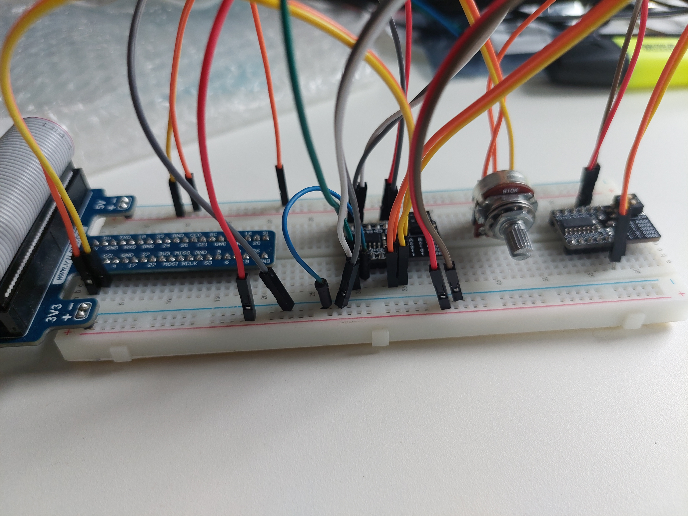
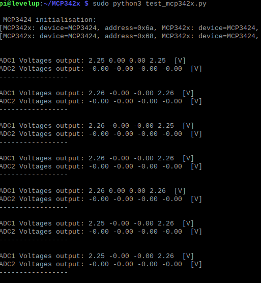

# MCP3424 18-bit ADC — Temperature, Pressure & Power Measurement

Python driver scripts for the **Microchip MCP3424** 18-bit, 4-channel delta-sigma ADC with **PGA**, on a **Raspberry Pi** over **I²C**. Two MCP3424 chips measure **4 NTC temperature sensors**, **3 pressure transmitters** and **1 current/power input**, with averaging and calibration.

<p align="center">
  
</p>

## About the MCP3424

- 4 differential input channels
- I²C interface (up to 8 addresses: `0x68`–`0x6F`)
- On-board 2.048 V voltage reference
- Up to **18-bit** resolution (12 / 14 / 16 / 18 bits selectable)
- Input range ±2.048 V (differential)
- Programmable gain amplifier (PGA): ×1, ×2, ×4, ×8

## Channel Map

| ADC address | Channel | Signal | Resolution / Gain |
|-------------|---------|--------|-------------------|
| `0x69` | CH0–CH3 | Temperature T1–T4 (NTC 10 kΩ, B = 3435) | 18-bit, ×1 |
| `0x68` | CH0–CH2 | Pressure P1–P3 (WNK83MA transmitter, 0–10 bar, 0.5–4.5 V) | 18-bit, ×1 |
| `0x68` | CH3 | Power / current (1 V ≙ 30 A) | 12-bit, ×2 |

## Signal Conditioning & Conversion

- **Resolution**: LSB = 2.048 V / 131 071 ≈ **15.6 µV** at 18 bits
- **Pressure**: a 10 kΩ / 6.8 kΩ divider scales 0–5 V down to the ADC range, followed by a linear calibration `P = m·steps + p`
- **Temperature**: the NTC sits in a divider from a 3.0 V reference (LM4128). Its resistance is converted with the **Steinhart–Hart** equation `1/T = a + b·ln(R) + c·ln(R)³`
- **Noise reduction**: each reading is averaged over 15 samples

Calibration results are in [`logs/`](logs/) and the calibration worksheet is in [`docs/`](docs/).

## Sample Output

<p align="center">
  
</p>

## Repository Structure

```
.
├── src/
│   ├── Temperature-Pressure-Power_mcp342x.py  # Standalone measurement script
│   ├── temperaturePressureProcess.py          # Measurement loop run as a separate process
│   └── lib_python_logging.py                  # Console + rotating file logger
├── tests/
│   └── test_mcp342x.py                        # Quick hardware check: prints raw voltages
├── lib/                                       # MCP342x Python library (source + package)
├── docs/                                      # Datasheet, schematic, calibration sheet, install notes
├── logs/                                      # Sensor calibration and validation results
├── photos/                                    # Lab setup and program output
└── requirements.txt
```

## Getting Started

```bash
# Enable I2C on the Raspberry Pi (raspi-config → Interface Options → I2C)
sudo apt install i2c-tools
i2cdetect -y 1            # the ADCs should appear at 0x68 / 0x69

pip3 install -r requirements.txt

python3 tests/test_mcp342x.py                    # raw voltages
python3 src/Temperature-Pressure-Power_mcp342x.py
```

The log file defaults to `/var/log/mcp3424/mcp3424.log`. Set the `MCP3424_LOG_FILE` environment variable to use a different path.

## Tech Stack

Python 3 · Raspberry Pi · I²C (smbus) · MCP342x · Steinhart–Hart · multiprocessing · Azure Pipelines

## Author

**Akram M'Tir**, [@amtir](https://github.com/amtir)
